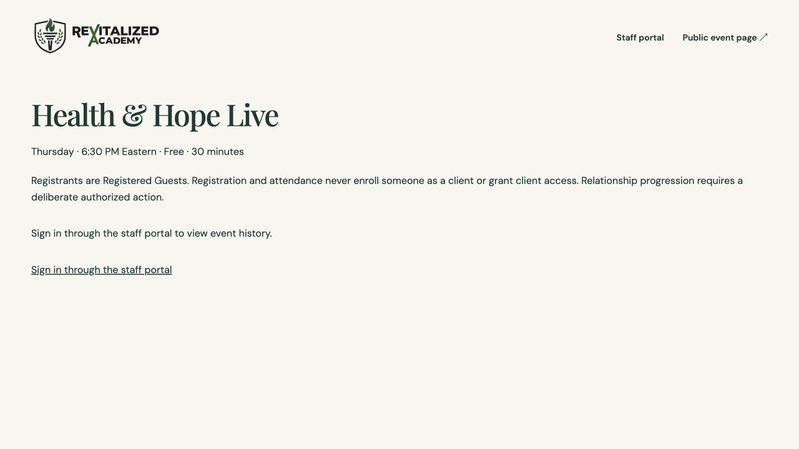

# Health & Hope Live — controlled hosted acceptance

October 20, 2026. Approved application/test source: `760ef11`; isolated branch `codex/health-hope-live`. This record supplements the frozen [release scope](HEALTH_HOPE_LIVE_FINAL_LAUNCH_GATE_2026-10-20.md), without changing its migrations, Function archives or deployed asset manifest.

## Owner authorization

The owner explicitly authorized the four hash-pinned event migrations in dependency order, three event Functions, required event staff assets, secure event/Resend configuration, one synthetic registration and confirmation exclusively to `dave@theboss.biz`, a host-assisted joining test and authorized event QA cleanup. Successful manifest/dependency/security preflight is required before each dependent action. Public registration, automated Zoom attendance, bulk/participant communications, payments, unrelated migrations/permissions, Roadmap scoring and Founders design changes remain prohibited. Stop after controlled acceptance; public activation needs separate approval.

The approved sender is `ReVitalized Academy <noreply@auth.revitalizedacademy.com>`, Reply-To `contact@revitalizedacademy.com`. The synthetic identity is HHL Acceptance Test, marketing off, one confirmation maximum, request `5577813d-27f3-4a70-adae-c85a44dfc2b2`. Actual session/revision/operator/window must be pinned before the case is enabled; this record does not fabricate those values or authorize other recipients.

## Founder-confirmed Zoom statements

The owner relayed these seven direct confirmations from Justyn Oliver for existing recurring meeting `82516112925`:

1. Meeting link ready for guests.
2. No meeting passcode.
3. Waiting Room enabled.
4. Guests can join without a Zoom account.
5. Join before host disabled.
6. Justyn or a designated team member will host.
7. Their account has previously supported three-hour Zoom sessions.

These are **founder-confirmed statements, not independently verified technical results**. The historical duration statement is not a verified current plan/license or named alternative-host entitlement. No account settings were changed or credentials requested. Preserve the exact supplied attendee URL, recurring meet-anytime meeting and website schedule: Thursday 6:30 PM `America/New_York`, thirty minutes. Website registration creates Registered Guests in the existing CRM; Zoom-native registration is not required.

Automated attendance remains a post-launch option. The approved authorized manual attendance workflow requires verified identity, actual session evidence, staff/contact scope and audit history; this technical test must not be credited as Thursday attendance.

## Joining test status

The exact supplied attendee URL loaded Zoom's invitation page and offered app/browser entry. This proves URL loading only. No passcode, anonymous guest access, Waiting Room, blocked early entry or host admission has been technically verified.

The owner answered that the host is unavailable now and requested test preparation. Automatic approval review rejected entering the browser joining flow because the required host-assisted prerequisite was unavailable. The action was not performed or retried by another route. Resume only when Justyn/designated host is ready; use synthetic display name `HHL QA – Synthetic`, no camera/audio, no setting changes or actual event attendance credit. The authorized confirmation test remains separately bounded to its exact recipient/case.

## Execution evidence

The authorized held installation is published as **`6ad81d507dce8c34a1e56c2d`**, source **`760ef11edae1f92b37cbdc135e02c4a0f44d1526`**, Git branch `codex/health-hope-live`. Public registration remains held. The original scope document/package is retained as the frozen approval reference; this execution record supersedes its historical “not installed/not authorized” status only within the owner's controlled-stage authorization.

## COMPLETED / CHANGED

- All four original event migrations applied once, in their exact documented version order: `20261020141529`, `20261020193400`, `20261020201535`, `20261020215108`. Source checksums match the frozen package. Initial connector migration requests returned `Invalid or expired requestState`; read-only checks proved no partial execution. A supported CLI workspace was initialized/linked in a private temporary directory, fetched the existing migration ledger, and dry-ran **exactly these four pending files** before one scoped application. No unrelated migration, role/seed file or B6 version `20261020201519` was replayed. The temporary workspace was removed.
- Published exactly three new Node 22 event Functions and four reviewed staff paths: updated `/portal/index.html`, plus `/portal/health-hope-live.html`, `.css` and `.js`. **450 total paths; 446 retained, one update, three additions, zero removals.** All ten existing Function archives, configuration/routes and payment schedule are preserved. Two new minutely event schedules are installed with their runtime/database controls held.
- The public homepage, popup, approved event design/gold buttons, Founders page, Roadmap assets, opaque runtime configuration and site/beta settings retain their reviewed digest contracts. The publication lock remains on. No primary/Founders worktree was edited and no Git push occurred.
- Staged sixteen production-only, Function-scoped HHL bindings: all enablement flags false, acceptance delivery latch selected, approved sender/Reply-To, and five secret bindings. Supabase keys were transferred directly from authorized management access into Netlify secret storage; a new Resend **sending-only, approved-domain-restricted** credential was stored directly as a secret. Existing credentials were not replaced. No credential values were printed, added to source, or included in evidence.
- Created only the event's five-event signed Resend feedback hook, verified its **disabled** state, and stored its signing secret in the same production-only Function scope. Existing hooks are unchanged. No actual confirmation/reminder or marketing message was sent.

## TESTED / SECURITY

- Approved commit, all four SQL checksums, three ZIP checksums/input fingerprints, four staff source digests and exact 450-path/13-Function request scope pass preflight. No website or backend application source was changed from `760ef11`.
- Hosted catalog verification preserves **370 pre-existing shared function definitions/owners/ACLs/search paths**, **584 existing RLS policies**, and **all 30 original roles**. The supported CLI additionally created its provider-managed `cli_login_postgres` authentication role: no original role attributes changed, its short-lived credential is now expired, and it has zero active connections. This authentication artifact is recorded separately rather than falsely claiming the global role set is byte-identical. No app/staff/client permissions were expanded.
- Eleven event tables have RLS and deny direct SELECT to `anon`, `authenticated` and `service_role`; the two public command wrappers retain their intended service-only/staff-only grants. Actual hosted anonymous REST calls to both wrappers return **401 / 42501**. The service-role wrapper accepts the correct `privacy-maintain` action with retention disallowed and returns `{held:true}` without writes. No identity/session was impersonated.
- Provider security advisors retain the three hosted baseline notices, with **zero new findings/warnings/errors**. Initial SQL dependency checks and current guest-stage constraint preserve all six existing lifecycle values and add only the three approved guest/prospect values.
- Unpublished and canonical checks pass for all four served staff paths and all thirteen Function identities/schedules. The established strict anchor-only Pretty URL normalization handles Netlify's HTML rewrite; no arbitrary HTML normalization or relaxed content check was introduced. Canonical served bytes match the accepted candidate. Public sessions return an empty Eastern-time list; public registration returns **503 `registration_held`**; unsigned staff requests return **401 `sign_in_required`**. The actual staff browser page displays sign-in-required with no guest data.
- Final database state: zero sessions, registrations, jobs, attendance records or privacy cases; zero CRM contacts for the synthetic inbox; null acceptance case; registration/Zoom/notifications/retention/provider-readiness flags false. Retention SQL is installed, but a live maintenance heartbeat/export/deletion case is **not** claimed as tested. It needs the authorized operator/readiness stage.
- Previous approved local retention/consent/deduplication/DST/desktop/mobile tests remain applicable to the unchanged source and were not rerun. The actual hosted synthetic persistence, inbox delivery and Zoom admission are still unperformed.

## SENDER / PROVIDER RETENTION

Resend's approved auth-subdomain is freshly verified/sending-enabled with tracking off. Actual account limits show capacity for the one-message test (100 daily / 3,000 monthly). The owner then explicitly confirmed: **“Yes—standard 30 days, no custom extension.”** Record the actual account retention as owner-confirmed, alongside the published provider policy; this is not an independently inspected billing/contract screen. A plan name is not inferred from quota. The provider browser reaches sign-in and no credentials were requested in chat. No further Resend retention-duration decision is pending.

Resend publishes thirty-day email/log retention on Free/Pro/Scale and seven-day backups. The owner's confirmation establishes the current account's standard period. Document the authenticated deletion/export handling and other applicable provider arrangements before the genuine operator's readiness attestation; do not equate eventual vendor expiry with completed cleanup today. [Resend retention/security](https://resend.com/security), [data-processing terms](https://resend.com/legal/dpa).

Zoom publishes fifteen-month meeting diagnostic retention; default cloud recording/chat retention may differ and depends on account settings. The seven founder statements do not establish recording/chat/report retention or provider deletion arrangements. Do not assume the Academy's twelve-month CRM event purge deletes independent vendor records, and do not attest cleanup without evidence. Obtain the account operator's applicable customer-data retention/cleanup arrangements; no change to the approved twelve-month event-history period is being requested or implemented. [Zoom data-retention standard](https://support.zoom.com/hc/en/article?id=zm_kb&sysparm_article=KB0074786).

The prepared [confirmation preview](health-hope-live-hosted-acceptance-2026-10-20/confirmation-preview.json) uses the unchanged approved renderer, exact recipient/From/Reply-To and supplied recurring link, with Thursday October 22 at 6:30 PM EDT as a **planning value only**. No actual Thursday session/revision/window has been created or approved through the staff workflow yet. Required event consent will be affirmative and optional marketing off. No additional live email, reminder or recipient is implied.

## UNRESOLVED / NEXT RECOMMENDED BUILD

| Requested acceptance result | Status |
| --- | --- |
| Hosted migrations and three event Functions | **PASS**, installed held |
| Registration → Registered Guest CRM → selected Thursday | **BLOCKED**, authorized operator and provider readiness pending |
| Actual confirmation delivery | **BLOCKED**, no email sent; exact case/payload and readiness must be verified first |
| Zoom guest joining and host admission | **BLOCKED**, host unavailable; invitation page loaded only |
| Synthetic event cleanup | **BLOCKED**, no synthetic records exist yet; temporary CLI workspace cleanup passed |
| Existing system protections | **PASS**, shared functions/policies/original roles and existing production assets/Functions preserved |
| Public registration activation | **HELD**, controlled acceptance must pass, then separate explicit approval |

The next owner/operator actions are: complete applicable provider cleanup/Zoom retention evidence; sign in normally as an existing active/onboarded Owner/Admin with CRM management and All People scope at [the held event staff page](https://revitalizedacademy.com/portal/health-hope-live), then report readiness; and make Justyn/designated host available for one synthetic admission. The owner replied **“I’ll sign in and reply when ready”**; this does not assert an authenticated operator is ready yet. Resend's standard thirty-day period is now confirmed. Do not provide passwords, passcodes, tokens or API secrets in chat. An unrelated founder/staff session or metadata-selected UUID is not a substitute for the genuine executing operator.

The existing controlled-stage authorization persists. Once prerequisites are ready, Codex can finish its already-authorized maintenance/readiness check, pin the existing seven-key thirty-minute case in DB/runtime, verify actual selected session/revision/recipient/payload, conduct exactly one confirmation to `dave@theboss.biz`, verify signed feedback and recipient receipt, perform the host-assisted technical join, then hold delivery/drain pending case work and use audited scoped event cleanup. Do not remove the master CRM contact or fake a provider-cleanup attestation. Keep public registration, marketing and automated Zoom off throughout. No additional development or repeated architecture approval is needed to resume this scope.

**Later smallest public release approval, only after acceptance passes:** enable the prepared public registration attribute and reviewed server/database registration plus operational confirmation/reminder controls for verified future Thursdays; retain independent twelve-month maintenance and existing manual attendance controls; clear the QA case/latch deliberately. Keep automated Zoom reporting/webhooks, payments and unrelated systems unchanged. This approval is neither requested for immediate execution nor inferred from the controlled-stage authorization.

## ROLLBACK / CLEANUP CAPABILITIES

The full previous/current digest manifests, original and executed requests, operation journals and artifact checksums are retained. On any failed acceptance gate, keep public registration and delivery held; expire/clear the QA scope only after pending/in-flight work is drained; keep independent privacy maintenance available once enabled. Use a narrowly reviewed forward fix/held compatible deployment, never an automatic restore of an older website, shared-data rollback, dropped privacy schema, erased-identifier restoration or migration replay. No synthetic production data currently requires deletion. The event-only Resend hook is disabled; its restricted sending key is stored securely and unused. Provider-owned expired CLI authentication was not destructively removed or reused.

## DOCUMENTATION / CHAT HANDOFF

CURRENT_BUILD_STATE.md, ARCHITECTURE.md, SECURITY_MODEL.md and DECISIONS.md receive current execution addenda. [Execution evidence](health-hope-live-hosted-acceptance-2026-10-20/final-production-state.json), [database protection checks](health-hope-live-hosted-acceptance-2026-10-20/database-verification.json), [hosted RPC boundaries](health-hope-live-hosted-acceptance-2026-10-20/hosted-boundaries.json), [database hold](health-hope-live-hosted-acceptance-2026-10-20/final-database-hold.json), [sender configuration metadata](health-hope-live-hosted-acceptance-2026-10-20/sender-staging.json). No secret values are included.

Chat handoff: Held HHL backend/staff installation is live as 6ad81d507dce8c34a1e56c2d/source760ef11. Four exact event migrations installed once; 3 new Functions plus 10 retained; 450 paths/446 retained/one portal update/three staff additions; publication locked. Original 370 functions/584 policies/30 roles preserved; provider CLI login expired with zero connections. Existing public design, Founders, Roadmap, payments and beta protected. Event sender/key/feedback secrets staged; own feedback hook disabled; all event enablement flags false. No guest, session, job or email exists. Founder-confirmed Zoom statements recorded, technical join pending host availability. Provider retention evidence and genuine operator sign-in remain prerequisites to the already-authorized one-inbox acceptance. Public activation needs later separate approval. Primary release/grant operators must recognize the new production baseline rather than overwrite it or bypass their own baseline guards.

## WORK TASK NEEDED

RECOMMENDED THINKING LEVEL: MEDIUM

Copy-ready owner/account-operator assignment:

> Resend's standard thirty-day email/log period with no custom extension is owner-confirmed; do not ask for that decision again. Document its authenticated export/deletion process and, in Justyn's Zoom account, current recording/chat/participant-report retention and applicable customer-data deletion handling; the approved Academy event-history period remains twelve months and independent provider records must be documented accurately. Do not change settings, create accounts, record a meeting, export actual participant information or send messages. Sign in normally as an existing authorized ReVitalized Owner/Admin with CRM manage/All People access at https://revitalizedacademy.com/portal/health-hope-live and report Operator ready through the owner, without sending credentials. Arrange one short host-assisted guest test for HHL QA – Synthetic using the existing meeting 82516112925; report Host ready only when the intended host can admit that guest. The existing controlled acceptance permits one confirmation exclusively to dave@theboss.biz after exact case/sender/session/payload/readiness checks; keep public registration, marketing and automated Zoom disabled. Report actual results separately from founder statements; do not credit this technical join as Thursday attendance or attest provider cleanup without evidence.

